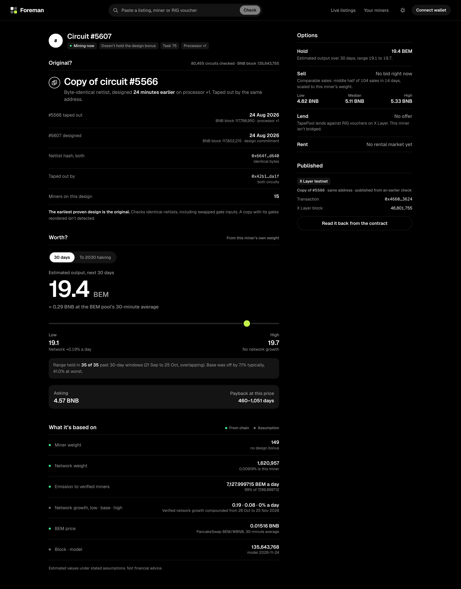
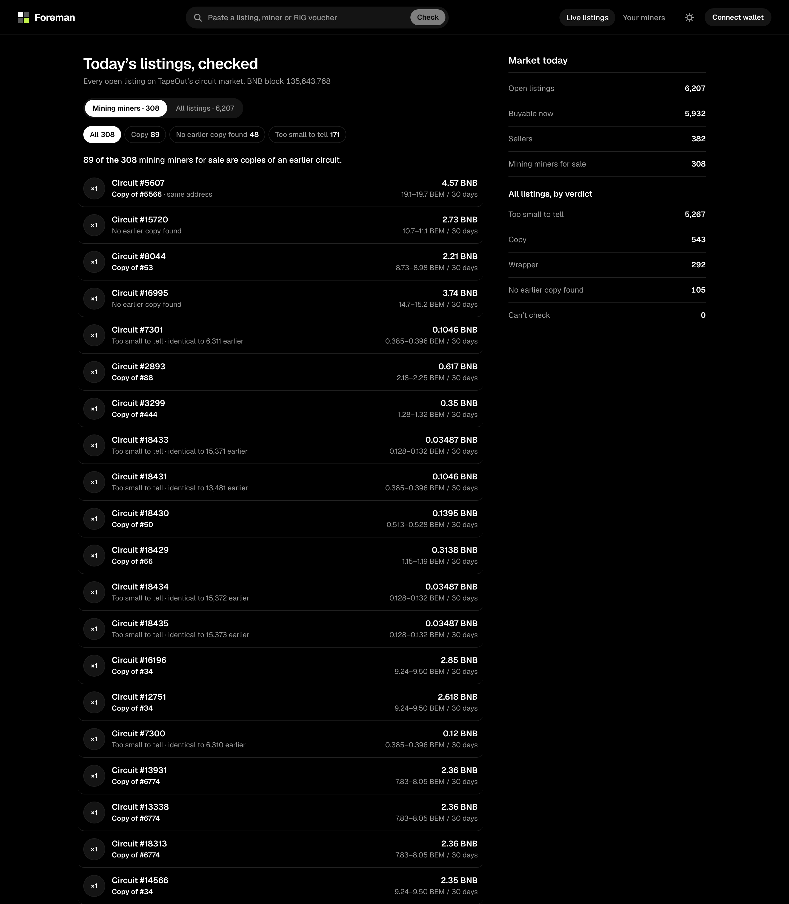
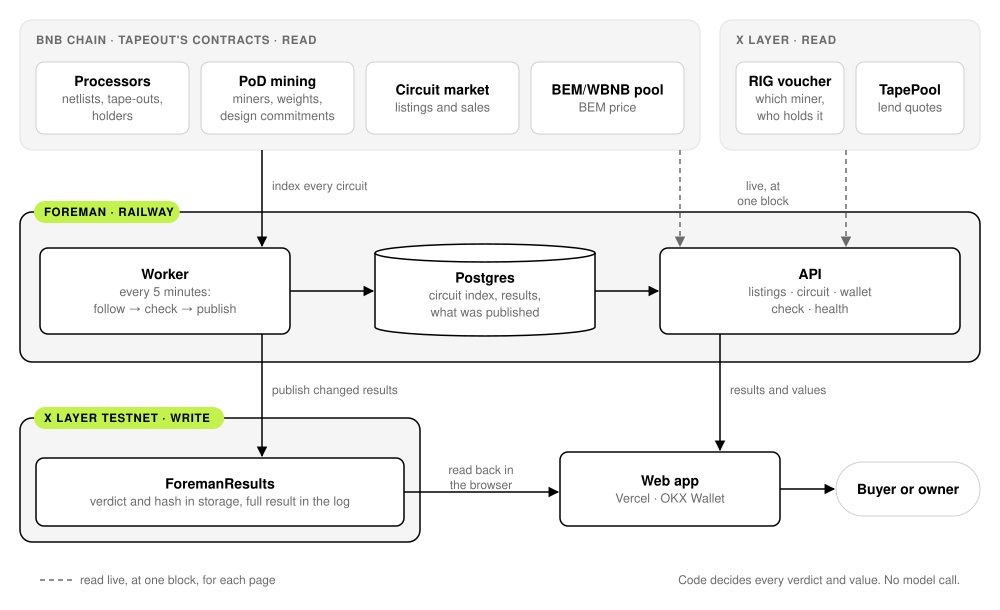

# Foreman

**Know what you're buying before you trade a TapeOut miner.**

For any TapeOut miner, listed circuit or RIG voucher, Foreman answers three questions and publishes the answers on X Layer:

1. **Is it original?** Exact copies and wrappers, with the evidence: which earlier circuit, both design times and the shared netlist hash.
2. **What's it worth?** An estimated value range and payback, from the miner's own on-chain weight, with every input shown.
3. **What can I do with it?** Hold, Sell, Lend and Rent, each shown as it really is today.

| | |
| --- | --- |
| **Web app** | https://foreman-eight-beta.vercel.app/ |
| **API health** | https://api-production-7065c976.up.railway.app/health |
| **Demo video** | Link added at submission |
| **Results contract** | ForemanResults on X Layer testnet (chain 1952): `0xe1b2343d3da66afec740c0fcaf40a701e2d513e8` |

Built for **X Layer TapeOut Accelerate** (OKX Build X).



Foreman never holds a miner, never lends, rents or trades, and never calls a circuit fake or stolen. It states what the chain shows. Values are estimates under stated assumptions. Not financial advice.

## The problem

A TapeOut miner is a circuit NFT that passed the official test vectors and earns BEM under Proof of Design on BNB Chain. Miners trade on TapeOut's circuit market, and since October 2026 they can be bridged to X Layer as RIG vouchers, sold there and borrowed against.

- **Copies cost nothing to make.** Anyone can tape out a byte-for-byte copy of someone else's circuit, or a netlist made only of REF records that points to another circuit, and list it. Nothing checked existing circuits (TAPs issue #102). On 25 November 2026, 89 of the 308 mining miners for sale on TapeOut's market were copies of an earlier circuit.
- **Prices are guesses.** Asking prices for mining miners ran from 0.015 to 222 BNB per unit of weight in November: sellers guess, and buyers can't tell a fair ask from a silly one.
- **Options are scattered.** Selling, borrowing and renting each live somewhere different, and some don't exist yet.

The market is small and early, and growing on X Layer: the time to put trust in place is before the money arrives.

## Who it's for

| User | What they get |
| --- | --- |
| **Buyers** | Before paying: is this listing a copy or a wrapper, what will it likely earn, and how long the asking price takes to pay back |
| **Owners** | What their miners are worth, and a copy alert when someone lists a copy of one |
| **Markets and wallets** | Originality results on X Layer that any contract or app can read, to stop listing copies and wrappers as compliant |
| **Lenders** (such as TapePool) | The same results before a loan, and a second opinion on value |

Foreman is free for buyers and owners. Markets and lenders can read the published results on X Layer today; an API for them, and premium alerts, are the paths to revenue.

## How it uses TapeOut and X Layer

- **Reads TapeOut's contracts on BNB Chain:** the Proof of Design mining contract (miners, weights, design commitments), the processor factory and every processor (each circuit's netlist and tape-out), and TapeOut's circuit market (listings and sales).
- **Reads X Layer:** RIG vouchers (which miner a voucher stands for, and who holds it) and TapePool's lending quotes.
- **Writes to X Layer:** every miner's and every listed circuit's originality result goes to Foreman's own contract, ForemanResults, which anyone can read and check.

Every address is listed under [Addresses](#addresses), each confirmed on chain before use, and the [architecture diagram](#how-it-works) shows how the pieces connect.

## Screens

**Live listings.** Every open listing on TapeOut's market, checked: copies, wrappers and circuits too small to tell, with each one's estimated output.



**Your miners.** Connect a wallet (OKX Wallet first) to see the miners it holds, and a copy alert whenever a circuit identical to one of them is listed.


<table>
<tr>
<td width="50%" valign="top">

**Read it back from the contract.** On any result page, your browser checks the published result straight from X Layer, not through Foreman: it finds the publish transaction, checks that the contract stores that result's hash, and compares the verdict with the page.

</td>
<td width="50%" valign="top">

**On a phone.** Every page is built mobile first.

</td>
</tr>
<tr>
<td valign="top"></td>
<td valign="top"></td>
</tr>
</table>

## What a result says

Every result names what was checked, against how many circuits and up to which block:

| Verdict | Meaning |
| --- | --- |
| **Copy of circuit #X** | Same netlist hash as circuit #X, which has an earlier design time. Names both circuits, both design times and the hash |
| **Wrapper of circuit #X** | The netlist is only REF records. Names the circuit they point to and the one at the end of the chain that holds the gates |
| **Too small to tell** | Identical to earlier circuits, but under 4 gates, where honest circuits match by nature: 7,520 miners of 1 to 3 gates share just 53 designs |
| **No earlier copy found** | No earlier circuit in the index has the same netlist hash, e.g. "among 80,455 circuits checked, up to BNB block 135,643,755" (25 Nov 2026) |
| **Can't check** | The netlist can't be read, or the circuit is outside the index |

**The rule: the earliest proven design is the original.** A circuit's design time is its design commitment block when the mining contract accepted one before its tape-out, otherwise its tape-out block. Within a block, the lower transaction index, then log index, is earlier. So a tape-out can't be front-run.

**The limit:** Foreman checks identical netlists, including swapped gate inputs. A copy with its gates reordered isn't detected.

Every result also says whether the circuit can mine: mining now; can't mine (and why); stopped (and when it can start again); or not started.

## Published on X Layer

Every miner's and every listed circuit's result is written to Foreman's results contract, **ForemanResults**, on the **X Layer testnet (chain 1952)**: `0xe1b2343d3da66afec740c0fcaf40a701e2d513e8`. The source is verified on Sourcify (exact match). It isn't upgradeable, and only one publisher address can write to it.

A worker follows BNB Chain every 5 minutes and publishes a circuit again when its verdict, its evidence or its can-mine state changes. A later index block or a higher circuit count alone isn't a change.

**Re-check any result yourself:**

1. **The short verdict in storage:** call `resultOf(processor, circuitId)`. It returns the verdict kind (1 no earlier copy found, 2 copy, 3 too small to tell, 4 wrapper, 5 can't check), the can-mine state (1 mining, 2 can't mine, 3 stopped, 4 not started), the BNB block the index was read up to, and `resultHash`.
2. **The full result in the log:** the `Published` event of the publish transaction carries the result as JSON, with its evidence, rule version and block.
3. **Tie them together:** `keccak256` of the logged bytes equals the stored `resultHash`.
4. **Redo the verdict from BNB Chain:** the result names both circuits, both design blocks and the netlist hash. Read both netlists from the processor (`netlist(id)`), hash them by the rule above, and compare the blocks.

For example, circuit #5607 on processor `0xb1024b89886b9a34aa4ff5f31c411d708b20a14c` was published in transaction `0x466062da96b3c80a44494f8bf54c2129a6501074162e65d20d0a31414cc23624` at X Layer testnet block 46,801,755: copy of circuit #5566, which taped out at BNB block 117,798,950, before #5607's design commitment at block 117,802,215.

Results are on the testnet for the hackathon. ForemanResults isn't deployed on X Layer mainnet (chain 196).

## The forecast backtest

The payout maths mirrors the mining contract and is tested. The forecast, the low / base / high range of network growth, is backtested against what happened:

- **Test:** for every past start date with 30 days of history before it and 30 days after, the 30-day range the app would have shown that day, against what a verified miner of unchanged weight actually earned on the real network.
- **Result (model 2026-11-24, start dates 21 Sep to 25 Oct 2026):** the range held in **35 of 35** start dates. Base was below what miners earned every time: by 7.1% typically and 41.0% at worst, rounded up (the worst on 21 Sep, just after the network stopped growing fast).
- **Read it with care:** neighbouring start dates share most of their 30 days, so 35 start dates aren't 35 independent tests. The high case's rule, no network growth, was chosen after the earlier rule (the slowest week) held in only 13 of 34, on this same history. It would miss if the network shrank, which it hasn't so far.
- **Not tested:** the "until the 2030 halving" view, about 1,365 days, which 95 days of history can't test, and the low case's loss of the design bonus. The app says so.

Rerun it from the saved samples: `pnpm --filter @foreman/valuation backtest`. The rules are in `docs/decisions/2026-11-24-forecast-backtest.md` and `2026-11-24-high-case-no-growth.md`.

## Addresses

Every contract address Foreman reads or writes, each confirmed on chain before use:

| Chain | Contract | Address | Used for |
| --- | --- | --- | --- |
| X Layer testnet (1952) | ForemanResults | `0xe1b2343d3da66afec740c0fcaf40a701e2d513e8` | Foreman's published results |
| BNB Chain (56) | PoD mining contract (proxy) | `0x7e2e0dc66a3bd9103e69b766afa62d9f7b697b46` | Miners, weights, design commitments, claims |
| BNB Chain (56) | PoD mining logic | `0xa3dbe873da37cd4e4a13c7cef23a7db6ca60f898` | Verified source behind the proxy |
| BNB Chain (56) | BEM token | `0x5ce033b2bfca3af30b3e8c8457deaf776a8b695a` | Emission and claims |
| BNB Chain (56) | Processor factory | `0x68224f668083c29e9800be2a646d42d18cedf7e2` | Every processor, and through them every circuit's netlist and tape-out |
| BNB Chain (56) | Eligible processors | `0x1f5cb4aeae1807bf60c3b9c0d8adbcc14e91f12c` (×6), `0xb1024b89886b9a34aa4ff5f31c411d708b20a14c` (×1) | The two processors that can mine |
| BNB Chain (56) | TapeOut circuit market (proxy) | `0x6feebbebc07bcb90bd1ac8b0cf9baa4f0ff2b46f` | Listings, sales, asks |
| BNB Chain (56) | BEM/WBNB pool (PancakeSwap v3) | `0x28b12792f9d81bd529bc5572434e861c9edbbbc2` | BEM's 30-minute average price, for payback |
| BNB Chain (56) | Multicall3 | `0xca11bde05977b3631167028862be2a173976ca11` | Bundled reads at one block |
| X Layer (196) | RIG voucher | `0x9cfc959cd42b2e1d39a0d850c528210e818ae520` | Which miner a voucher stands for, and who holds it |
| X Layer (196) | TapePool account factory, pool, quote calculator (third party) | `0xa9014e27dd17ea30e4fa4f71934645b9dcef8ac8`, `0x1a9a9850d597d8e3a03afae48e3ac8e2d4aec9d7`, `0xfcc669bc9cca397cb01804035d5be981d7389ef2` | Lend offers against RIG vouchers |

## How it works

<picture>
  <source media="(prefers-color-scheme: dark)" srcset="docs/diagrams/architecture-dark.svg">
  
</picture>

1. **Index.** Every circuit on every BNB Chain processor, from one scan of `TapedOut` events with each processor's count checked against its `nextId()`. Then each netlist and each miner's design commitment. Followed every 5 minutes.
2. **Check.** Each netlist is hashed: its input and output counts and bytes, with each NAND's two inputs put in order. Same hash and an earlier design time is a copy; only REF records is a wrapper.
3. **Value.** Expected output = miner weight ÷ verified network weight × daily emission × 99%, with halvings on schedule. Low assumes the fastest week of network growth in the last 30 days, base the growth over those 30 days, high no network growth. Payback compares the asking price with that output at BEM's 30-minute pool average.
4. **Market.** Sell shows recent sales and asks of comparable miners, picked by a stated rule. Lend shows TapePool's live quote or why there's none. Rent shows that no rental market exists yet.
5. **Publish.** Changed results go to ForemanResults on X Layer, each with its rule version and the block it was read at.
6. **Show.** The live listings page checks every open listing. The result page shows the three answers with their evidence. **Your miners** shows a connected wallet's miners, and a copy alert when a copy of one is listed.

No verdict, value or comparison comes from a model: code decides, from chain data.

**Stack:** TypeScript throughout. viem for both chains; Postgres with plain SQL; a Hono API and a pg-boss worker on Railway; a Vite and React web app with wagmi on Vercel; the results contract in Solidity with Foundry. An uptime monitor watches `/health`, which also warns when the publisher wallet runs low on OKB.

## Limits today

- **Results are on the X Layer testnet**, not mainnet.
- **BNB Chain circuits only.** Circuits taped out on X Layer aren't indexed yet.
- **Reordered gates aren't detected.** Only identical netlists, including swapped gate inputs, count as copies.
- **OCCC status isn't shown.** No deployment of Official Curated Circuit Collections has been confirmed on chain yet.
- **Copy alerts show in the app** while a wallet is connected. Telegram and browser notifications aren't built.

## Run it locally

Needs Node 24, pnpm 11 and Docker.

```bash
pnpm install
docker compose up -d
cp .env.example .env
```

Fill in `.env`: `BNB_ARCHIVE_RPC_URL` (a BNB Chain archive node), `BNB_ARCHIVE_LOG_BLOCKS` (logs per read; `50000` for NodeReal) and `DATABASE_URL` (the local Postgres from `docker-compose.yml`). The index is built by `pnpm --filter @foreman/index follow`; the first build reads every circuit since launch and takes a while.

```bash
pnpm --filter @foreman/api serve
```

```bash
pnpm --filter @foreman/web dev
```

The web app runs on http://localhost:5173 against the API on port 8787. `pnpm test` runs every package's tests; the database tests need `TEST_DATABASE_URL`.

## Repository

| Path | What |
| --- | --- |
| `packages/contract` | The data contract: the shared types and their parsers |
| `packages/chain-bnb` | BNB Chain reader: miners, network state and history, the circuit market |
| `packages/chain-xlayer` | X Layer reader: RIG vouchers, TapePool offers, reading a published result back |
| `packages/originality` | Netlist reader, hashing, copy and wrapper checks, the tape-out scan |
| `packages/index` | The circuit index's storage in Postgres |
| `packages/valuation` | Estimated value, payback, Sell comparables and the forecast backtest |
| `contracts` | ForemanResults (Solidity, Foundry) |
| `apps/api` | The API, the publish job and the worker |
| `apps/web` | The web app (Vite, React, wagmi) |
| `docs` | Product, data contract, decisions, research notes, mocks, screenshots |

The rules behind every verdict and value are in `docs/decisions/`, each dated, and `docs/data-contract.md` defines every shape the API returns and the contract stores.

## Credits

Built by William. **Furqaan Nabi** ([@furqaannabi](https://github.com/furqaannabi)) built the data contract (`packages/contract`), the BNB Chain reader (`packages/chain-bnb`) and the archive backfill, which Foreman reuses.
